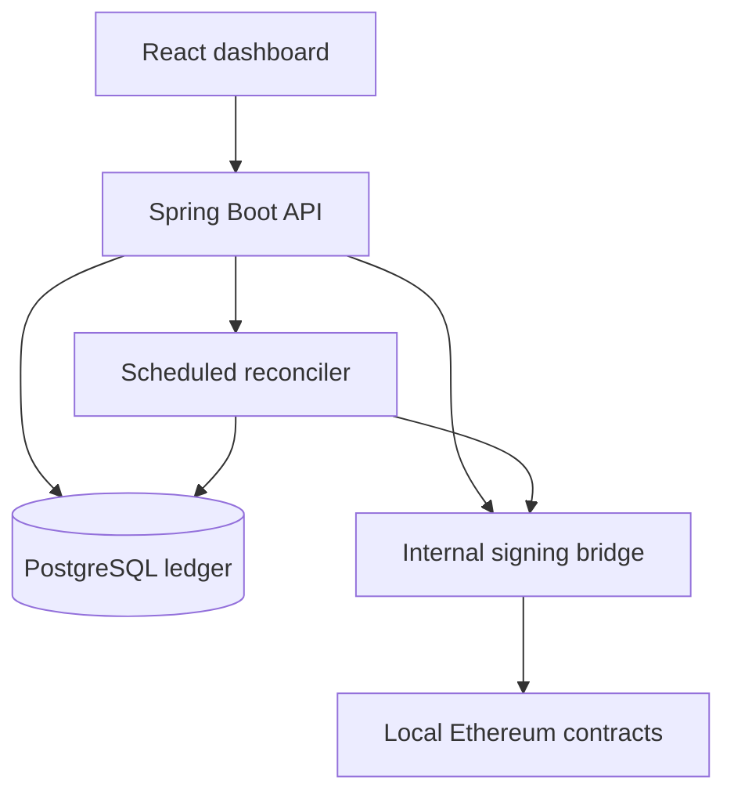

# TreasuryFlow

### Programmable Corporate Payments

An educational v1 of a supplier-payment workflow: request → approve → settle → reconcile.

**React + TypeScript · Spring Boot 3 / Java 17 · PostgreSQL 16 · Solidity · local Ethereum (Ganache).**

No real funds, personal information, KYC, bank connection, or JPMorgan integration. The hosted dashboard is an explicitly labelled, browser simulation saved on this device. The Docker project uses real EVM contracts and a persistent PostgreSQL ledger.

## Live company workspace

Open `/app` on the hosted website to sign in with ChatGPT and create a company. The live workspace uses an authenticated server API, D1 structured storage and protected R2 PDF storage. It is separate from the synthetic browser demo and the local Spring Boot/PostgreSQL/EVM system.

Working features: company workspaces, email-bound invitation links, role permissions, supplier creation/editing/archiving, invoice submissions and PDF attachments, independent approvals, rejection and revision, manual bank payment records, statement matching, in-app reminders, reports, exports and server-written audit history. Owners can revoke member access. No money is moved by the hosted workspace; no invitation email or bank connection is implied.

See [hosted setup and boundaries](docs/FULLSTACK.md).

## Complete website rebuild

The default screen is a new public website with a full-bleed harbor hero, capability carousel, full-screen navigation, interactive approval explorer, payment journey, supplier/team directory, reliability scenarios, FAQs and payment tracking. Its calls to action open the working payment form and workspace.

The workspace has a new horizontal navigation and preserves creation, approvals, rejection, execution, reconciliation, audit export, search and filters. Tracking searches the same payment records by invoice, payment ID or transaction hash. Demo records survive refresh on this device; Demo lab offers a confirmed reset. The API-backed local system remains available with `?mode=api`.

See [complete rebuild notes](docs/COMPLETE-REBUILD.md) for scope and verification limits.

## Start the complete local system

Install Docker Desktop with Compose (Windows: enable WSL 2). From this project folder:

```sh
cp .env.example .env
# Windows PowerShell: Copy-Item .env.example .env
docker compose up --build -d
```

After the initial images finish building, open **http://localhost:8088/?mode=api**. If the backend is still starting, retry after a few seconds.

Use `creator`, `manager1`, `manager2`, or `auditor`; the local default password is **treasury-demo-only** (or your `DEMO_PASSWORD`). Changing the account prompts you to reconnect. The database starts empty; create the first payment in the interface.

- `creator`: create requests and execute approved payments.
- `manager1`, `manager2`: approve/reject; either may execute approved requests.
- `auditor`: inspect payments/events and run reconciliation; cannot create, approve, reject or execute.

Only port **8088 on loopback** is exposed. The signing bridge, RPC, backend and database remain on the private Compose network. Do not expose this educational setup to the internet.

```sh
docker compose logs -f backend
docker compose stop       # keeps ledger and chain volumes
docker compose start
# DESTRUCTIVE local reset; deletes both local ledger and chain:
docker compose down -v
```

Open http://localhost:8088/ without `?mode=api` for the seeded browser simulation. Its role picker and records are not authentication or blockchain settlement; records survive refresh when browser storage is available. Reset them from Demo lab.

## Standout demo

1. Create a due-today payment for 100 mUSD.
2. Switch to `manager1` and approve.
3. Switch to `creator`; open the payment and choose **Execute with interrupted response**.
4. The API intentionally returns 503 after chain confirmation but before updating the ledger. The ledger remains `EXECUTING`.
5. Open Reconciliation and run it, or wait up to 30 seconds for automatic recovery. It restores `SETTLED` using the original transaction hash.
6. Retry execution: the ledger returns the same settlement; the contract independently rejects a second execution.

The automated script also tests duplicate submission and an unauthorized auditor approval:

```sh
npm ci
npm run demo:api
# Also restart the actual backend process before reconciliation:
RESTART_BACKEND=true npm run demo:api
# PowerShell: $env:RESTART_BACKEND='true'; npm run demo:api
```

Failure injection requires `DEMO_FAILPOINTS=true` (enabled for the demo Compose setup). The backend default without Compose is false. A 503/timeout never means a payment did not settle.

## Rules and implementation

| Requirement           | Implementation                                                                                          |
| --------------------- | ------------------------------------------------------------------------------------------------------- |
| Unique request        | Client-generated UUID; same UUID + same payload returns original. Changed payload conflicts.            |
| Invoice deduplication | Database unique `(recipient, normalized invoice)`; invoice uppercase/trimmed.                           |
| Approved suppliers    | Two synthetic recipients, checked by backend and contract.                                              |
| Approval threshold    | 1 manager up to and including 5,000; 2 distinct managers above 5,000 mUSD.                              |
| Daily limit           | 25,000 mUSD across all executions, enforced atomically on chain per UTC day.                            |
| Due date              | UTC midnight of supplied date; future requests can be approved, not executed.                           |
| Money arithmetic      | Java BigDecimal; on-chain integer units (6 decimals); browser model uses BigInt checks.                 |
| Duplicate execution   | Immutable bytes32 ID and executed flag; contract checks-effects-interactions.                           |
| Recovery              | Persist `EXECUTING` before submission; confirmed events repair status after an interrupted response.    |
| Reconciliation        | Compare recipient, amount, transaction identity, and confirmation; flag missing and orphan settlements. |
| Audit                 | Application decisions + chain events with unique transaction/log keys; JSON export.                     |

Invoices, names, and documents are off-chain. The contract sees a random UUID-derived hash, wallet addresses, amount, due timestamp, and actors. Even these metadata are observable to chain participants. No invoice-document upload is included in v1.

## Architecture



The Node bridge compiles/deploys Solidity and signs local transactions with seeded test accounts. The bridge is a **trusted signing component**; compromising it compromises signer authority. See [threat model](docs/THREAT_MODEL.md).

Contract actions are immutable; no recipient admin screen, policy editing, upgrades, token mint endpoint, cross-chain bridge or production key custody is implied. Policy changes require a fresh local deployment/reset.

## Repository

```text
frontend/           React dashboard and isolated browser simulation
backend/            Spring Boot API, JDBC ledger, Basic demo authentication
contracts/          TreasuryFlow and MockUSD Solidity contracts
chain/              Local chain, private signing bridge, EVM tests
scripts/            Build and end-to-end demonstration
compose.yaml        PostgreSQL + chain + backend + nginx UI
.github/workflows/  Build, tests, Compose integration and process restart
```

## Development and tests

Requirements: Node **22.18+**, Java **17**, Maven **3.9+** (Docker avoids installing Java/Maven locally).

```sh
npm ci
npm run build:demo           # standalone demo + legacy Docker frontend
# Full hosted build additionally requires dependencies in hosted/ (see docs/FULLSTACK.md).
npm run build                # frontend + hosted Worker and migrations
npm test                     # actual EVM tests and browser model tests
npm run dev                  # visit http://localhost:5173/dev.html
```

Java integration tests use H2 in PostgreSQL compatibility mode and a real local chain, not a mocked settlement client:

```sh
# Terminal 1: use a fresh CHAIN_DATA directory for a fresh test chain
BRIDGE_SECRET=local-bridge-secret-change-me CHAIN_DATA=/tmp/treasury-tests npm run chain
# Terminal 2
LIVE_CHAIN=true mvn -f backend/pom.xml test
```

Tests deliberately skip without `LIVE_CHAIN=true`; an ordinary `mvn test` is not evidence of integration coverage. CI enables it and additionally runs the complete PostgreSQL Compose stack. Tests cover authentication, access denial, payload conflicts, invoice uniqueness, dual approval, duplicate settlement, due dates, rejection, and interrupted settlement recovery/mismatch detection. The EVM suite additionally covers aggregate daily limits and failed token-transfer rollback.

For a local Java developer process, start PostgreSQL and the chain, then use `mvn -f backend/pom.xml spring-boot:run` with the configured database/bridge environment. Visit Vite's `/dev.html?mode=api`; its `/api` proxy targets port 8080.

## Evidence and documentation

- [Verification results and limitations](docs/VERIFICATION.md)
- [API contract and examples](docs/API.md)
- [Threat model and trust boundaries](docs/THREAT_MODEL.md)
- [Two-minute walkthrough](docs/WALKTHROUGH.md)

## Why blockchain?

A shared settlement state and independently enforced conditions can help when several organizations need to verify payments without relying exclusively on one participant's database. This prototype demonstrates the mechanics, not a decentralized institutional deployment: all test keys are controlled by the local bridge.

If one company controls every participant and no outside party needs independently verifiable settlement, an ordinary database, approval workflow, and payment-provider API are simpler and usually sufficient. A blockchain is not needed merely to move value between records.

## Known v1 boundaries

Single backend process and serialized bridge writes; not a high-availability distributed system. Full event scans suit a small local chain, not production scale. One local confirmation, no reorg rollback strategy. Basic demo accounts, known local chain mnemonic, immutable mock eligibility, unaudited contracts. Application audit rows are mutable by a database administrator; chain event history is the independent evidence. This is a portfolio prototype, not a production banking system.

## Resume wording

**TreasuryFlow — Programmable Treasury and Blockchain Settlement Platform**

Built a React, Spring Boot, PostgreSQL and Solidity supplier-payment prototype with role-based approvals, on-chain spending controls, idempotent execution and event-driven reconciliation. Demonstrated recovery after interrupted settlement and tested unauthorized actions and duplicate-payment prevention.

Only add gas numbers and test counts from the checked verification report. No institutional endorsement is claimed.

## Open the portable demo immediately

The delivered ZIP includes **TreasuryFlow-demo.html**. Double-click it in Chrome or Edge. It is fully bundled, works offline, and uses simulated settlement with local browser persistence. The complete project does not require the hosted preview service. To regenerate the portable demo, run `npm run build`; it appears under `release/`.

## Redesigned financial workspace

The updated interface includes a live overview, searchable/sortable payments, an approval and settlement drawer, a validated two-step payment form, interactive settlement history and consistent reconciliation/audit screens. API mode polls every five seconds and reads available balance and daily spend from the local contract. The standalone HTML remains a clearly labelled simulation.

See [redesign notes and verification](docs/REDESIGN.md) for implemented interactions, data boundaries and testing limits. `npm test` now includes mounted React DOM interaction tests as well as EVM/business-rule checks.
